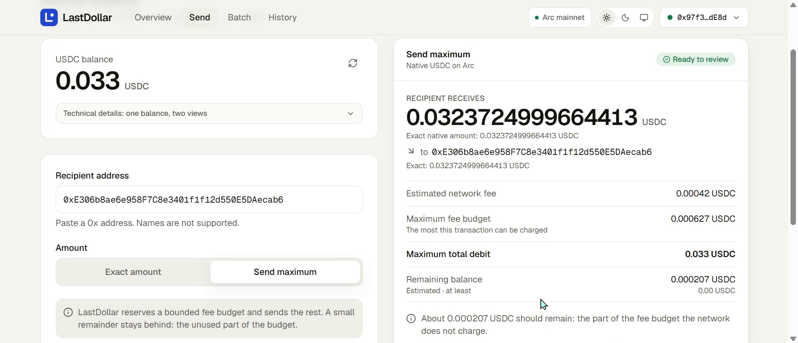
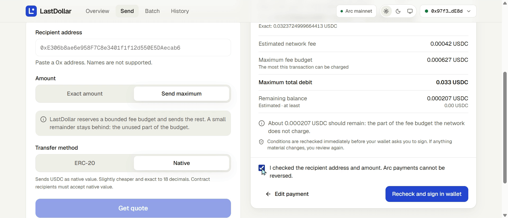
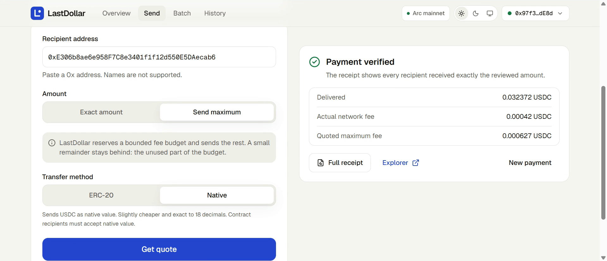
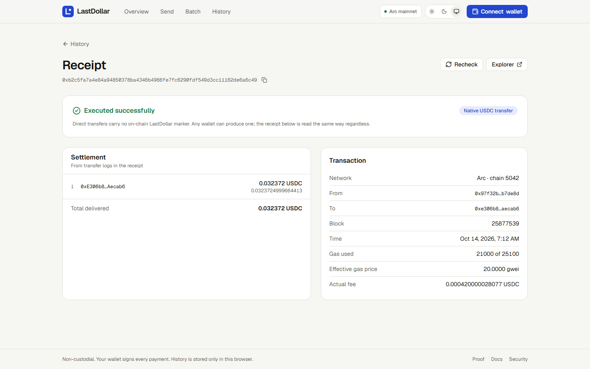
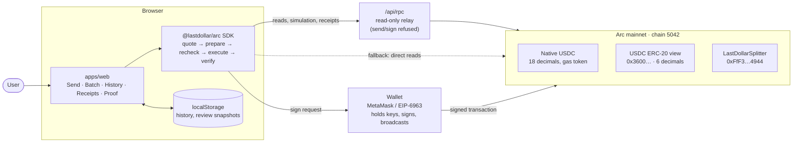
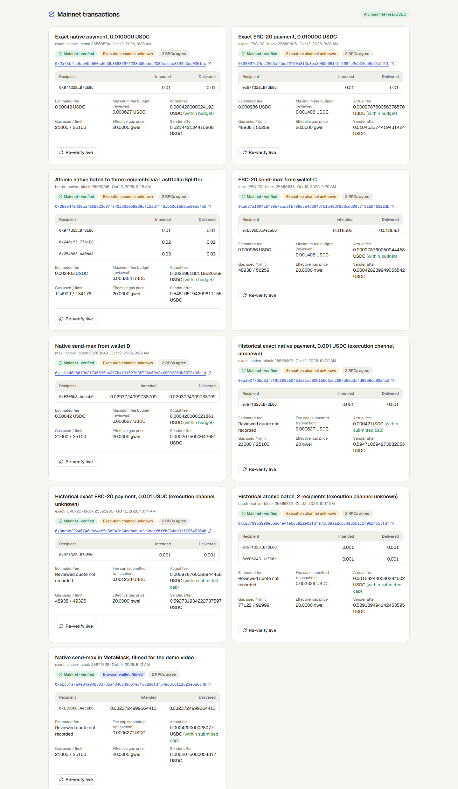
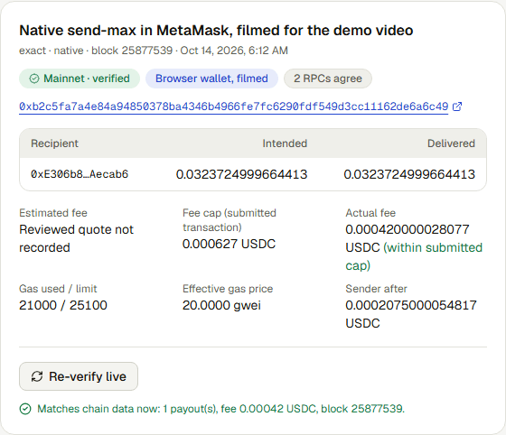

# LastDollar

**Send exactly what you intend. Know what it costs. Verify what arrived.**

On Arc, USDC is both the money you send and the gas you pay to send it. Paying someone exactly 25 USDC, or sending everything you have, means working out the fee from the same balance. LastDollar quotes the payment and the fee together, rechecks both just before your wallet asks you to sign, and afterwards reads the chain receipt to confirm what actually arrived.

- **Live app:** https://lastdollar.vercel.app (Arc mainnet, real USDC)
- **Mainnet evidence:** https://lastdollar.vercel.app/proof · [evidence/mainnet/proofs.json](evidence/mainnet/proofs.json)
- **Demo video (2:23):** [video/out/lastdollar-demo.mp4](video/out/lastdollar-demo.mp4), a real send-max signed in MetaMask on mainnet ([transaction](https://explorer.arc.io/tx/0xb2c5fa7a4e84a94850378ba4346b4966fe7fc6290fdf549d3cc11162de6a6c49))
- **SDK:** [`packages/sdk`](packages/sdk) (`@lastdollar/arc`, TypeScript, viem)

> **Before you try it with MetaMask:** MetaMask currently shows a risk warning for `lastdollar.vercel.app`. We believe it is a false positive (the site has no server-side signing, no key handling, and its source is all here), but it has not been cleared yet. You can read every request in MetaMask before approving, and you can use the proof page and receipt lookup without connecting a wallet at all.


<sub>The quote from the filmed demo payment: 0.0323724999664413 USDC to the recipient, estimated fee 0.00042, at most 0.000627, about 0.000207 left behind.</sub>

## Who it is for

Intended users. These are the cases the tool was built for, not established customers:

- **Someone paying an exact amount**, such as an invoice, who needs the recipient to get exactly that and wants to know the total cost first.
- **Someone moving their whole balance** to another wallet, who needs the largest amount that still leaves enough for the fee.
- **Someone paying several people** who wants all payouts in one signed transaction that either fully succeeds or fully fails.
- **Developers building on Arc** who need the same calculations, rechecks and receipt checks in their own app (the SDK).

## Three workflows

Numbers in the first column are illustrative. Real mainnet runs are linked in the last column.

| Workflow | What you enter | What LastDollar shows before you sign | Real run |
|---|---|---|---|
| **Exact payment** | Recipient, `25 USDC` | Recipient receives 25.00 · estimated fee · maximum fee budget · total debit · projected balance left | [native](https://explorer.arc.io/tx/0x2a73bfe16ae49a560ad6e0b8888f677228e06bdec2082c1eae8394c3cc03611c), [ERC-20](https://explorer.arc.io/tx/0x20097e74da7563afdbc22760a313c8ea2950e0614ff568fe2db34ce8e6fd42fb) (0.01 USDC each) |
| **Send maximum** | Recipient, *Send maximum* | The largest amount after reserving a bounded fee budget, and the small amount that will stay behind | [filmed in MetaMask](https://explorer.arc.io/tx/0xb2c5fa7a4e84a94850378ba4346b4966fe7fc6290fdf549d3cc11162de6a6c49): 0.033 → sent 0.0323724999664413, 0.0002075 left |
| **Batch** | Recipients and amounts, or a CSV | Every recipient and amount, the total, and one fee for the whole batch | [3 recipients](https://explorer.arc.io/tx/0x36e3472439ba7259523c97fe40a365959239c712adff461b50d1568ce90dcf55) through `LastDollarSplitter`, one transaction |

### How this differs from a plain wallet transfer

A wallet transfer signs whatever amount you type and reports success when the transaction is included. LastDollar adds four things around that same transfer:

1. **The amount and the fee are worked out together** from one balance read at one block. Native USDC (18 decimals) and the ERC-20 view (6 decimals) are reconciled, so the two are never mixed up.
2. **The worst case is shown before signing**: the maximum fee budget the signed transaction allows, not only an estimate.
3. **A recheck just before the wallet opens.** Balance, nonce and fees are read again and the exact request is simulated. If the terms changed, you review again instead of signing stale numbers.
4. **Afterwards, the receipt is read back from chain logs** and compared with what you reviewed: delivered amount per recipient, the actual fee, and whether the wallet changed the gas settings.

Some wallets do parts of this too. This is not a claim that wallets get it wrong.

## Using the app

1. Open https://lastdollar.vercel.app and choose **Open app**.
2. **Connect wallet** (MetaMask or any injected / EIP-6963 wallet). If the wallet is on another network, quoting is disabled (*Switch to Arc to quote*) until you switch.
3. **Send**: paste a `0x` recipient, choose **Exact amount** or **Send maximum**, and **ERC-20** or **Native**. **Batch**: add rows or import a CSV (`recipient,amount[,reference]`).
4. **Get quote** and read the card: recipient receives, estimated fee, maximum fee budget, maximum total debit, remaining balance.
5. **Review payment**, check the full address, tick the confirmation, then **Recheck and sign in wallet**.
6. Approve in your wallet. LastDollar tracks the transaction and shows **Payment verified** (or exactly what differed).
7. **Full receipt** shows the settlement from chain logs. Any hash can be looked up at `/app/transactions/<hash>`, with no wallet needed.

| Review | Result | Receipt |
|---|---|---|
|  |  |  |

## Fee economics, in short

Measured on mainnet (receipts):

| | Native transfer | ERC-20 transfer | Splitter batch, 3 recipients (1 funded, 2 empty accounts) |
|---|---|---|---|
| Gas used | 21,000 | 48,938 | 114,909 |
| Fee at Arc's 20 gwei floor | 0.00042 USDC | 0.000979 USDC | 0.002298 USDC |

- LastDollar adds no fee of its own.
- **Send-max leaves the unused fee budget behind.** It has to reserve the most the transaction could cost, and the network usually charges less. In the filmed run, exactly that unused budget remained: 0.0006275 − 0.00042 = 0.0002075 USDC.

**Batches. Gas estimates for this configuration—not executed benchmarks.** `eth_estimateGas` at Arc block 25910201 (2026-10-14), from `0xE306…cab6` to the splitter, 1 wei per recipient:

| Recipients | Batch, non-empty recipient accounts | Batch, empty recipient accounts | Separate native transfers (calculated, 21,000 each) |
|---|---|---|---|
| 1 | 44,316 | 69,457 | 21,000 |
| 3 | 70,196 | 144,719 | 63,000 |
| 4 | 83,137 | — | 84,000 |
| 10 | 159,838 | 407,980 | 210,000 |

In these estimates, batching used less gas from four recipients onward for the tested existing addresses. "Existing" here means non-empty accounts. This is not a general break-even point.

- The extra cost comes from *empty* recipient accounts (nonce 0, balance 0, no code). On Arc, as under the EVM's EIP-161 rule, a value transfer from inside a contract to an empty account costs about 25,000 more gas. A normal top-level transfer to the same account still costs 21,000. That is why the measured 3-recipient batch, with two empty recipients, used more gas than three separate transfers would have.
- Gas is not the whole cost. The fee is gas × the price at inclusion, so under different fee conditions lower gas doesn't automatically mean fewer USDC spent.
- Whatever the gas, a batch gives one signature and all-or-nothing execution.
- Ideas to lower batch gas (dropping the splitter's duplicate `Payout` event, merging its two loops) are unmeasured and would need a redeployment.

Full breakdown, and what has not been measured yet: [docs/economics.md](docs/economics.md).

## Architecture



```
apps/web          Next.js 16 app: landing, app (send, batch, history, receipts), proof, docs
  └ src/app/api/rpc   the only server code: read-only relay to Arc's official RPCs
packages/sdk      @lastdollar/arc: quote, prepare, revalidate, execute, verify (viem peer dependency)
contracts         LastDollarSplitter.sol (≤200 recipients, holds no funds) + Foundry tests
examples/node     exact, max, batch and receipt scripts outside the web app
tools             network checks, deployment, proof recording, evidence verification, pack test
evidence          machine-readable mainnet evidence, network checks, test results (no secrets)
docs              documentation, also rendered at /docs
video             Remotion project and rendered demo
```

### Trust boundaries

| Part | Does | Never does |
|---|---|---|
| **Your wallet** | Holds keys, shows and signs the request, broadcasts it | — |
| **App and SDK** | Read chain state, compute and explain costs, build the request, reconcile the receipt | Hold keys, sign, switch networks, send without your approval |
| **`/api/rpc` relay** | Forwards allow-listed read methods to Arc's official RPCs (64 KB request limit) | Send, sign or store anything; those methods return 403 |
| **LastDollarSplitter** | Forwards exactly the authorised native payouts in one call | Hold value; any failed payout reverts the whole batch |
| **Browser storage** | Remembers your history and the terms you reviewed (30-day expiry) | Decide settlement; status is always re-read from chain |

LastDollar cannot stop a wallet from rewriting gas settings (it detects and reports it), cannot stop you from approving something different in the wallet, and cannot protect a compromised browser. Details: [docs/architecture.md](docs/architecture.md) and [docs/security.md](docs/security.md).

## Evidence


<sub>The live proof page: each mainnet payment, its intended and delivered amounts, fees, gas, and a <b>Re-verify live</b> button that re-reads the chain from your browser.</sub>

Every entry was reconciled on two independent RPC providers (`rpc.mainnet.arc.io` and `rpc.drpc.mainnet.arc.io`) before it was recorded. Anyone can re-check them all:

```sh
pnpm install && pnpm sdk:build
pnpm contracts:build     # Foundry; the verifier also checks the deployed splitter bytecode against this build
pnpm verify:evidence     # 9 mainnet entries, 2 RPCs, exits non-zero on any difference
```

### How each transaction was made

Two RPCs agreeing proves the chain facts. It does not prove which interface created a transaction, so the way each one was made is recorded separately:

| How it was made | Entries | What backs that |
|---|---|---|
| **Signed in MetaMask in the live app, on film** | `browser-native-max` | The [demo video](video/out/lastdollar-demo.mp4) shows the quote, review, MetaMask confirmation and result. The proof page labels it *Browser wallet, filmed*. |
| **Signed by the SDK with a local key** (`tools/run-mainnet-proof.mjs --execute`) | `native-exact`, `erc20-exact`, `native-batch`, `erc20-max`, `native-max` | The recorded session log of that run (2026-10-12, 09:28:37–09:29:20 UTC): its captured output shows four of the hashes submitted or verified, and all five entries were written inside that window. The runner also stored the pre-signing quote, which only it records. Labelled *SDK script evidence*; this label was **added retrospectively on 2026-10-14**, and each entry records the basis. |
| **Reported by the owner as made in the live app** | `browser-native-exact`, `browser-erc20-exact`, `browser-native-batch` | The owner's report only. Labelled *Execution channel unknown*, with the reviewed quote marked as not recorded. |

The proof page also lists baselines: a naive full-balance native send **rejected by the node** before inclusion, `eth_call` simulations that **accepted** naive transfers (so simulation alone doesn't show the problem), and a fee-aware plain-viem calculation for comparison.



### What is tested

| Layer | Command | Result at the recorded commit |
|---|---|---|
| SDK unit and property tests | `pnpm test` | 72 passed |
| SDK against a local chain with real signing | `pnpm test:integration` | 8 passed |
| Splitter contract: unit, fuzz, invariant | `pnpm test:contracts` | 22 passed |
| Browser end-to-end: flows, stale quote, rejection, batch, pending recovery, 7 widths × 2 themes, axe | `pnpm e2e` | 26 passed |
| Mainnet behaviour | `pnpm verify:evidence` | 9 entries verified on 2 RPCs |

Source: [evidence/test-results/summary.json](evidence/test-results/summary.json). The browser tests use a labelled wallet stub on a local chain. Real wallet extensions are covered only by the manual mainnet runs above.

## SDK

Registry publication is pending, so install from a build of this repository:

```sh
git clone https://github.com/TheWeirdDee/lastdollar && cd lastdollar
pnpm install && pnpm sdk:build
cd packages/sdk && npm pack                 # lastdollar-arc-0.1.0.tgz
# in your project
npm install /path/to/lastdollar-arc-0.1.0.tgz viem
```

```ts
import { createPublicClient, createWalletClient, custom, http } from 'viem'
import { arc } from 'viem/chains'
import { arcMainnet, executePayment, parseUsdc, preparePayment, quoteExactPayment } from '@lastdollar/arc'

const publicClient = createPublicClient({ chain: arc, transport: http() })
const [account] = await createWalletClient({ chain: arc, transport: custom(window.ethereum!) }).requestAddresses()
if (!account) throw new Error('No wallet account')
const walletClient = createWalletClient({ account, chain: arc, transport: custom(window.ethereum!) })

const quote = await quoteExactPayment({ publicClient, account, recipient: '0xRecipient…', amount18: parseUsdc('25'), mode: 'erc20', config: arcMainnet })
if (quote.status === 'blocked') throw new Error(quote.blockers.map((b) => b.message).join('; '))

// Show quote.lines, quote.fee.estimatedFee18, quote.fee.maxFeeBudget18 and quote.maxDebit18 to the user first.
const result = await executePayment({ walletClient, publicClient, plan: preparePayment(quote), config: arcMainnet })
console.log(result.receipt.status) // 'verified' | 'mismatch' | 'reverted'
```

Runnable Node examples, read-only unless you pass `--execute` with `PRIVATE_KEY` set:

```sh
cd examples/node
node verify-receipt.mjs --hash 0xb2c5fa7a4e84a94850378ba4346b4966fe7fc6290fdf549d3cc11162de6a6c49
# Status:     observed
# Operation:  native-transfer
# Actual fee: 0.00042 USDC (21000 gas)
# Delivered:  0xE306b8ae6e958F7C8e3401f1f12d550E5DAecab6 0.0323724999664413 USDC

node max-transfer.mjs --from 0x97f32Ba0b4DD5c274DFD9C2A7e6Aa403a9B7dE8d --to 0xE306b8ae6e958F7C8e3401f1f12d550E5DAecab6 --mode native
# Status:               blocked (1 estimate round(s))
# Balance:              0.0002075000054817 USDC
# Blocked: INSUFFICIENT_GAS_FUNDS The balance (0.000207 USDC) does not exceed the maximum fee budget (0.000627 USDC).
```

That second output is the wallet from the demo, after its send-max: what is left is less than one fee budget, so there is nothing more to send. Errors have stable codes (`STALE_QUOTE`, `INSUFFICIENT_GAS_FUNDS`, `WRONG_CHAIN`, `RECEIPT_TIMEOUT`, and others). The full API is in [docs/sdk.md](docs/sdk.md). Supported: Node 22.13+ and modern browsers, with any viem `WalletClient` that has an account. Smart-contract accounts (EIP-4337, EIP-5792) are not supported yet.

## Development

Requirements: Node 22.13+, pnpm 11.5.0, [Foundry](https://getfoundry.sh) for contracts.

```sh
pnpm install
pnpm sdk:build
pnpm dev                     # http://localhost:3000
pnpm typecheck && pnpm lint
pnpm test && pnpm test:contracts && pnpm test:integration && pnpm e2e && pnpm test:pack
```

Deployment needs no secrets. Optional public variables: `NEXT_PUBLIC_SITE_URL`, `NEXT_PUBLIC_SPLITTER_ADDRESS`, `NEXT_PUBLIC_ARC_RPC_URL`. See [docs/deployment.md](docs/deployment.md).

## Troubleshooting

| You see | What it means / what to do |
|---|---|
| MetaMask risk warning on the site | See the note at the top. Check every field in the MetaMask request before approving, or use the proof page without connecting. |
| MetaMask's "Estimated changes" doesn't match LastDollar | On Arc, MetaMask's balance-change preview can offset the fee. LastDollar's review and the receipt show the actual amounts. |
| *Switch to Arc to quote* / `WRONG_CHAIN` | The wallet is on another network. Switch it to Arc; quotes and signing stay disabled until then. |
| `INSUFFICIENT_GAS_FUNDS` | The balance doesn't cover the maximum fee budget, so nothing can be sent. Add USDC. |
| Asked to review again / `STALE_QUOTE` | Balance, nonce or fees changed between quote and signing. Read the new numbers and confirm again. |
| Quoting blocked: pending transaction | The account has an unconfirmed transaction. Wait for it; History recovers it after a refresh. |
| `RECEIPT_TIMEOUT` | The transaction was sent but no receipt arrived in time. The outcome is unknown, not failed. Open the receipt link later or check the explorer. |
| Receipt says the wallet changed the gas settings | Your wallet changed the gas limit or fee caps from what you reviewed. The receipt compares the fee against your reviewed budget. |
| Reads fail or time out | The relay forwards to Arc's official RPCs and the app falls back to direct reads. If both fail, Arc RPC is unavailable; nothing is signed. |

## Documentation

| Doc | For |
|---|---|
| [Architecture](docs/architecture.md) | Components, lifecycle, trust boundaries, evidence pipeline |
| [Fee economics](docs/economics.md) | Measured costs, batch comparison, send-max remainder, what isn't measured |
| [Payment math](docs/payment-math.md) | The integer arithmetic for exact, max and batch |
| [SDK guide](docs/sdk.md) | Install, configure, every function, errors, wallet behaviour |
| [Security](docs/security.md) | Threat model, contract properties, limitations |
| [Network verification](docs/network-verification.md) | Each Arc fact LastDollar relies on and how it was checked |
| [Mainnet proof](docs/mainnet-proof.md) | How evidence was produced, recorded and re-checked |
| [Testing](docs/testing.md) | Test layers and how to run them |
| [Deployment](docs/deployment.md) | Vercel, splitter deployment, environment |
| [Demo script and edits](video/SCRIPT.md) | What the video shows and what was cut |

## Limitations

- **Not audited.** Internal tests only. Keep amounts modest.
- **MetaMask flags the domain.** Not yet cleared (see above).
- Quotes are conditional. The maximum fee budget caps what the transaction can be charged; it is not the fee you will pay.
- Send-max leaves the unused fee budget behind (and, in ERC-20 mode, a sub-micro remainder). It never promises an empty wallet.
- History is local to one browser and covers only payments made through this app.
- Browser wallets via EIP-6963 and injected providers only; no WalletConnect or smart-account batching yet.
- `0x` addresses only; no name resolution.
- Wallets that rewrite gas parameters are detected and reported, not prevented.
- The splitter's source is not verified on the explorer yet (its API blocks scripted clients). Its bytecode is verified against this repository on two RPC providers.
- Value has moved only between the builder's own wallets. This shows the mechanics work, not that anyone has adopted the tool.

## What's next

Not built yet: publishing the SDK to npm, getting the MetaMask warning reviewed, verifying the splitter source on the explorer, WalletConnect support, measured batch costs at larger recipient counts, and an external security review.

## License

[MIT](LICENSE). Dependencies (viem, wagmi, Next.js, React, TanStack Query, Radix, lucide, Geist, Tailwind CSS, forge-std) are MIT, Apache-2.0, ISC or OFL-1.1, compatible with MIT distribution.

LastDollar is an independent project, not affiliated with Circle or Arc.
